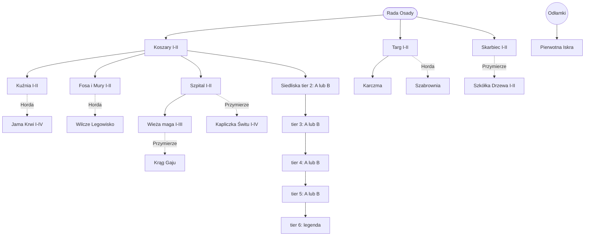

# Budynki osady: stan obecny i propozycje

Dokument do ustalenia zależności między budynkami (backlog, punkt 37, zakres 3). Część 1 to to, co jest w kodzie
(`src/engine/kingdom.ts`, `economy.ts`, `empire.ts`), część 2 to **propozycje nowych budynków** (nic z tego nie jest
zrobione), część 3 to pytania do Ciebie. Ceny i liczby są z kodu na 17.11.2026.

Zasady wspólne: w osadzie można budować **dowolnie wiele budynków na rundę** (od 17.11 limit zniknął, ogranicza tylko koszt). Poziom gry decyduje, które budynki
w ogóle istnieją. Obcej (zdobytej) osady nie rozbudujesz o Koszary. „Rada Osady” (nazwa ustalona 17.11) będzie
dodatkowym, darmowym, zawsze stojącym budynkiem, który otwiera drzewko budowy.

## 0. Decyzje autora z 17.11.2026 (wieczór): mają pierwszeństwo przed resztą dokumentu

Poniżej ustalenia z rozmowy; sekcje 2 i 3 niżej są historyczne (propozycje i pytania), gdzie sprzeczne, obowiązuje ta sekcja.
Graf zależności („co blokuje co”) jest ustalony w sekcji 0a poniżej.

**Zasady ogólne**
- **Limit „jeden budynek na rundę” znika, na wszystkich poziomach gry.** Ogranicza złoto i surowce. Skutki: `mayBuildNow` i `KingdomState.built` do usunięcia, komunikat „W tej rundzie budowaliście już” też; boty budują tyle, na ile je stać; **golden, pasma i `tuneLevels.ts` do przestrojenia**; zaktualizować `INSTRUKCJA.md`, `ZASADY_CYFROWE.md` (sekcja o osadach), `ROZBUDOWA_CYFROWA.md`.
- **Dwa systemy rekrutacji zostają:** poziomy 3–5: Koszary I/II z progami tierów (jak dziś); poziom 6: siedliska.
- **Koszary II dają +1 miejsce pomocnika w drużynie** (już tak jest, maks. 5). Jeśli to za mało, dodatkowy bonus dopiero po testach. Pomysł K1 (pojemność garnizonu zależna od Koszar) odrzucony.
- **Zasada „najlepszy poziom w całej frakcji”** dla budynków dających efekt bitewny lub globalny (Kuźnia, Kapliczka Świtu, Jama Krwi). **Budynki dające dochód lub zasoby (Skarbiec, Szkółka Drzewa, Szabrownia) sumują efekty ze wszystkich osad.**

**Lista budynków wspólnych (15 miejsc w podglądzie osady)**
1. Targ (+ulepszenie), 2. Szpital (+ulepszenie), 3. Skarbiec (+ulepszenie), 4. Kuźnia (+ulepszenie), 5. Fosa + wieżyczki, 6. Karczma, 7. Wieża maga (+ulepszenia; **trzy kręgi = trzy poziomy**), 8. budynek Pierwotnej Iskry (poziom 6), 9. Rada Osady, 10. Koszary, 11. Siedliska: po jednym miejscu na tier 2–6 (5 miejsc).
- **Koszary od poziomu 6 są wybudowane domyślnie w każdej osadzie.** Klik otwiera okno z listą jednostek do kupienia (kupuje się te, do których frakcja ma siedlisko). Dwa komunikaty przy niedostępnych: „wybrano alternatywne siedlisko tego poziomu” oraz „siedlisko jeszcze niekupione (możesz je kupić)”.
- **Siedliska (poziom 6):** dwa na każdy tier 2–5, wzajemnie się wykluczają; siedlisko 3. tieru wymaga jakiegoś siedliska 2. tieru itd.; tier 6 (legenda) ma jedno siedlisko bez alternatywy. Na krajobrazie siedlisko danego tieru stoi w tym samym miejscu co jego alternatywa.
- **Zakup jednostki w Koszarach zawsze trafia do wspólnej puli pomocników frakcji** (nie do drużyny konkretnego bohatera; limit miejsc zależy od bohatera).
- **Garnizon (do 3 pomocników) zmienia się tylko wtedy, gdy któryś bohater frakcji stoi w tej osadzie.** Pomocnik przechodzi między garnizonem a wspólną pulą.

**Unikalne budynki frakcji (po 3, razem 18 miejsc; ciasno, ale bez przejmowania się na razie)**
Drzewka frakcji z trzema rangami **znikają** (`kingdom.tree`, akcja kupna rangi, `TREE_NAMES`, `TREE_TEXTS`, pas „drzewko” w oknie osady). **Także podstawowe efekty Blasku Świtu i Żądzy Krwi wymagają budynku** (bez budynku frakcja nie ma tego efektu w bitwie).

| Frakcja | Budynek | Poziomy i efekt |
|---|---|---|
| Przymierze | **Kapliczka Świtu** (wygląd: kamienna kapliczka z promieniami światła) | 4 poziomy: I Blask Świtu (+1 Ż najciężej rannej jednostce na początku rundy bitwy); II leczy +2 Ż; III leczy dwie jednostki; IV każda jednostka startuje bitwę z +1 Ż |
| Przymierze | **Szkółka Drzewa** | I: +1 drewna na rundę, II: +2 (sumuje się z osad) |
| Przymierze | **Krąg Gaju** (wygląd: krąg kamieni z runami i świecącym kryształem) | bohater wchodzący na kafelek osady odnawia **całą manę** (dziś mana wraca +1 na koniec rundy, maks. 3 + poziom bohatera, mędrzec +3) |
| Horda | **Jama Krwi** | 4 poziomy: I Żądza Krwi (po śmierci wroga wszystkie jednostki Hordy +1 A, raz na bitwę); II dwa razy; III trzy razy; IV przy każdym zadziałaniu leczą 1 Ż |
| Horda | **Szabrownia** | dodatkowe złoto po wygranej z bohaterem lub strażnikiem (suma z osad) |
| Horda | **Wilcze Legowisko** | bohaterowie Hordy +1 punkt ruchu na mapie (jeden poziom) |

Orientacyjne ceny Kapliczki i Jamy (do strojenia; dziś rangi kosztują 4 zł + 2 Pyły / 6 zł + 3 Pyły / 8 zł + 5 Pyłów): I: 3 zł + 2 drewna + 1 Pył; II: 4 zł + 2 Pyły; III: 6 zł + 3 Pyły; IV: 8 zł + 5 Pyłów. Łącznie 11 Pyłów, a źródeł Pyłu jest 1–3, więc ceny pewnie wymagają obniżenia. Szkółka daje **drewno, nie Pył** (Pył jest najrzadszy; +1 Pył/rundę równałoby się własnemu Źródłu Pyłu).
Do sprawdzenia po wdrożeniu: Szkółka II w późnej grze (drewno traci znaczenie), siła Szabrowni i Legowiska, wpływ braku efektu frakcji we wczesnych rundach poziomu 6 na pasma.

## 0a. Graf zależności (ustalony 17.11.2026, zatwierdzony przez autora)

Zasady: **każdy budynek ma dokładnie jednego rodzica** (drzewo, bez krzyżowania i drugich wymagań); poziom II+ budynku wymaga jego
poprzedniego poziomu; wymagany jest rodzic na **poziomie I** (wystarczy wybudowany). **Pierwotna Iskra wymaga wyłącznie Odłamków**:
nie wymaga żadnego budynku i żaden budynek jej nie wymaga. Rada Osady stoi od początku (korzeń). Koszary od poziomu 6 są
wybudowane domyślnie (poziom I), więc zależności od nich są wtedy spełnione od początku. Siedliska i budynki unikalne istnieją od
poziomu 6. Graficzna wersja: artefakt „Graf budynków osady” (drzewa Przymierza i Hordy), źródło generatora poza repo.

Skutki uboczne uproszczenia (świadomie usunięte drugie wymagania): Koszary II dają tylko tiery 4–5 i +1 miejsce w drużynie (bez
dodatkowego powodu do ulepszenia przez Kuźnię II); legenda (tier 6) wymaga tylko siedliska tieru 5, nie Koszar II; Skarbiec II
nie blokuje Iskry. Jeśli testy pokażą, że któreś z nich brakuje, dopisać jako osobną decyzję.

## 1. Budynki, które już są

| Budynek | Od poziomu gry | Poziomy i koszt | Co robi |
|---|---|---|---|
| **Koszary** | 3 (Osada) | I: 3 zł + 2 drewna; II: 6 zł + 2 drewna + 2 rudy + 1 Pył | I: pozwala rekrutować pomocników (tier 1–3). II: tier 4–5 (najmocniejsze jednostki) i **+1 miejsce w drużynie** (maks. 5). Na poziomie 6 tu też stawia się Siedliska i rekrutuje legendarną jednostkę (II). |
| **Targ** | 3 | I: 3 zł + 2 drewna; II: 5 zł + 2 rudy + 1 Pył | I: trzy artefakty w ofercie (nowa oferta co 3 rundy), wymiana surowców za złoto. II (Duży targ): pięć artefaktów w ofercie, tańsza wymiana. Ceny artefaktów: 2 / 5 / 10 zł (legendarny dodatkowo 1 Pyłu). |
| **Szpital** | 3 | I: 3 zł + 2 drewna; II: 5 zł + 2 rudy + 1 Pył | I: wskrzesza poległych pomocników za połowę ceny. II: za jedną trzecią. |
| **Skarbiec** | 3 | I: 4 zł + 2 rudy; II (Wielki skarbiec): 6 zł + 2 rudy + 1 Pył (decyzja autora 18.11) | I: +1 złota na rundę; II: +2 złota na rundę (zamiast +1, nie dodatkowo). |
| **Kuźnia** | 4 (Księstwo) | I: 4 zł + 3 rudy; II: 6 zł + 3 rudy + 2 Pyły | I: pomocnicy **całej frakcji** walczą z +1 A. II: także +1 Ż. Liczy się najlepsza kuźnia we frakcji. |
| **Fosa / Mury z wieżyczkami** | 4 | I: 4 zł + 3 drewna; II: 6 zł + 4 rudy + 1 Pył | Obrona osady w bitwie: I fosa z kolcami (wejście = utrata tury i 2 obrażenia, przejście po moście), II mur z bramą i dwie wieżyczki strzelające co rundę; mur burzy tylko katapulta napastnika. |
| **Karczma** | 5 (Królestwo) | 5 zł + 3 drewna | Najem **drugiego bohatera** (dowódcy) z własnym pionkiem, doświadczeniem i artefaktami; wykup poległego dowódcy. |
| **Wieża maga** | 5 | I: 5 zł + 2 rudy + 1 Pył; II: 8 zł + 3 rudy + 3 Pyły | Uczy bohaterów czarów: I krąg (Pocisk, Leczenie, Spowolnienie, Wizja), II krąg (Kamienna Skóra, Kula Ognia, Zryw, Wrota). Decyzja 17.11: będą trzy kręgi, trzeci = trzeci poziom wieży (punkt 33). |
| **Pierwotna Iskra** | 6 (Imperium) | wszystkie Odłamki z mapy, przy jednym bohaterze | Dawn: +2 Ż wszystkim jednostkom; Horda: +1 A wszystkim. W celu „Relikt” wygrywa grę. |
| **Siedliska** (poziom 6) | 6 | od 2 zł + 1 drewna (tier 2) do 5 zł + 2 rudy + 1 Pył (tier 5) | Każdy tier 2–5 ma dwie jednostki; frakcja buduje siedlisko jednej z nich i druga jest na całą grę wykluczona. Wymaga Koszar. |

### Dlaczego Koszary wydają się bezużyteczne (analiza z kodu, bez pomiarów)

- To jedyny budynek, który **nic nie daje sam z siebie**: jest tylko bramką do rekrutacji. Wszystkie pozostałe budynki
  coś zmieniają natychmiast (złoto, artefakty, ulepszenie jednostek, czary).
- Na poziomach 1–2 pomocnicy są dani od początku, więc Koszar tam nie ma. Od poziomu 3 rekrutacja kosztuje 2–12 zł za
  jednostkę, więc Koszary są pierwszym wydatkiem, ale **tier 1–3 można kupić już na poziomie I**; poziom II (6 zł + surowce)
  daje tylko tier 4–5 i jedno miejsce w drużynie.
- Bot buduje Koszary pierwsze i niemal zawsze od razu poziom II, bo nie ma konkurencji: nic nie zmusza do wyboru.
- Pomysły naprawcze: patrz „Koszary: zmiany” niżej.

## 2. Propozycje nowych budynków i zmian

Każda pozycja ma: co robi, proponowany poziom gry, rząd wielkości kosztu, ryzyko dla balansu. Wszystko do Twojej
decyzji; zaznaczyłem, co moim zdaniem jest najtańsze i najbardziej opłacalne.

### Koszary: zmiany (żeby miały sens)

- **K1. Rozbudowa garnizonu:** poziom Koszar = liczba pomocników, których osada może trzymać w garnizonie (I: 1, II: 2;
  dziś garnizon nie ma związku z budynkami). Daje powód, żeby Koszary stały w *każdej* osadzie, nie tylko w jednej.
  Powiązanie z obroną: punkt 32 (garnizon broni osady bez bohatera). Moja rekomendacja.
- **K2. Szkolenie:** pomocnik rekrutowany w osadzie z Koszarami II startuje bitwę z +1 inicjatywą / pierwszym ciosem
  (lub +1 Ż w pierwszej bitwie). Mała, ale odczuwalna premia za rozbudowę.
- **K3. Zmiana progu:** poziom I rekrutuje tier 1–2, poziom II tier 3–4, a tier 5 wymaga nowego budynku (np. Cytadeli,
  niżej). Wtedy każdy poziom coś odblokowuje.

### Nowe budynki

| Propozycja | Poziom gry | Co robi | Koszt (rząd) | Uwagi |
|---|---|---|---|---|
| **Stajnie** | 3+ | Bohaterowie frakcji mają +1 pkt ruchu na mapie (II: +2). | 4 zł + 2 drewna / 6 zł + 2 rudy | Prosty efekt; wzmacnia szybkie ekspansje, w tym boty. |
| **Zbrojownia** | 4+ | Tańsze artefakty zwykłe i rzadkie o 1 zł lub drugie stoisko artefaktów (inna pula niż Targ). Konkuruje z Targiem. | 5 zł + 3 rudy | Daje powód do wyboru Zbrojownia vs Targ. |
| **Biblioteka / Akademia** | 5+ | Bohater odpoczywający w osadzie dostaje doświadczenie za rundę, albo +1 do wyboru umiejętności przy awansie. | 5 zł + 2 rudy + 1 Pył | Wzmacnia bohaterów, wspiera karczmę (drugi bohater). |
| **Świątynia / Sanktuarium** | 5+ | Bohater w osadzie odnawia całą manę i leczy; poziom II: po wyjściu z osady bitwa startuje z pełną maną. | 4 zł + 2 drewna / 6 zł + 2 Pyły | Uzupełnia Wieżę maga; samo nie uczy czarów. |
| **Warsztat oblężniczy** | 4+ | Katapulta napastnika w bitwie o osadę z murami (dziś „tylko katapulta burzy mur”); odpowiednik Murów po stronie ataku. | 4 zł + 3 rudy | Bez niego Mury II są nie do przejścia dla człowieka; sprawdzić w kodzie, skąd jest katapulta. |
| **Gildia kupców** | 4+ | Sprzedaż surowców za więcej złota albo +1 surowiec na rundę z każdej kopalni frakcji. | 5 zł + 2 drewna | Ekonomia; konkuruje ze Skarbcem. |
| **Cytadela** | 6 | Odblokowuje tier 5 / legendę (zamiast Koszar II) i daje zakrętkę: osada nie może być zdobyta w jednej bitwie (dwie fazy). | 8 zł + 3 rudy + 2 Pyły | Duża zmiana obrony; tylko jeśli chcesz rozbudować oblężenie. |
| **Obserwatorium / Wieża strażnicza** | 4+ | Odkrywa mapę dookoła osady lub pokazuje ruchy wrogich bohaterów w promieniu N pól. | 3 zł + 2 drewna | Przydatne w kooperacji i PvP z mgłą. |
| **Port** (tylko mapy z morzem) | 5+ | Dodatkowe punkty ruchu przy wodzie / przeprawa. | — | Wymaga nowego typu terenu; raczej parking. |

Moja skrócona rekomendacja, gdybyś miał wybrać mało: **K1 (garnizon z poziomu Koszar)**, **Stajnie**, **Zbrojownia**
(wybór zamiast Targu) i **Świątynia** (spina się z magią). Reszta to większa praca albo węższy zysk.

## 3. Pytania do Ciebie (żeby zamknąć graf zależności)

1. Które z propozycji K1–K3 dla Koszar (albo własna) wchodzą? To decyduje, czy Koszary są punktem wejścia drzewka.
2. Które nowe budynki chcesz (zostawić: nic, kilka, wszystkie)? Od którego poziomu gry każdy?
3. Zależności, które proponuję jako punkt wyjścia do poprawienia (tylko „co od czego”, bez sztywnych reguł):
   - Szpital, Kuźnia, Mury ← Koszary I (bo to budynki „wojskowe”),
   - Karczma, Gildia kupców, Zbrojownia ← Targ I (bo to budynki „ludzi i handlu”),
   - Wieża maga I ← Targ I (do ustalenia: albo Skarbiec), Wieża II ← Kuźnia I albo Świątynia I,
   - Pierwotna Iskra ← Skarbiec + warunek Odłamków (jak dziś),
   - poziom II każdego budynku wymaga jego poziomu I (już tak jest) plus ewentualnie jednego innego budynku.
   Wolisz drzewko **szerokie** (dużo budynków dostępnych od razu, mało zależności) czy **głębokie** (łańcuchy, trzeba
   planować)? Przy jednym budynku na rundę drzewko głębokie spowalnia rozwój botów, więc musiałbym przestroić poziomy.
4. Czy „jeden budynek na rundę” zostaje? Przy większej liczbie budynków może być zbyt wolne; alternatywa: jeden na rundę
   *na osadę*.

Po Twojej odpowiedzi wpiszę graf do `BUILDING_REQUIRES` (punkt 37, zakres 3) i do sekcji decyzji w `BACKLOG.md`.
